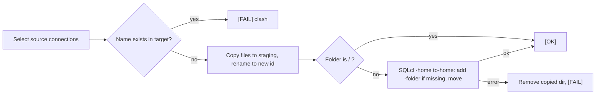
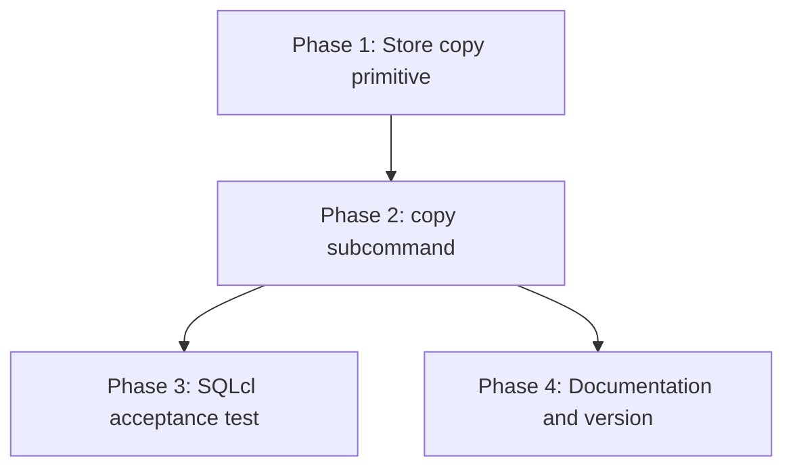

# Implementation Plan: Copy Saved Connections Between Homes

## Overview

Add a store-level primitive that copies one connection directory into another store under a new id, then a `copy` subcommand that selects source connections, refuses name clashes, copies each one, and places it in its source folder path through SQLcl run against the target home. An integration test proves SQLcl accepts the copy with its saved password. Documentation and the version bump close the task.

## Affected Files

| File | Change Type | Description |
| ---- | ----------- | ----------- |
| `src/sqlcl_conn_mng/store.py` | Update | `new_connection_id`, `ConnectionStore.copy_connection_to`, `ConnectionStore.remove_connection_dir` |
| `src/sqlcl_conn_mng/cli.py` | Update | `copy` parser, `_cmd_copy`, target runner, same-home and clash checks |
| `tests/test_store.py` | Update | Store copy tests |
| `tests/test_cli.py` | Update | `copy` command tests |
| `tests/integration/test_copy_compat.py` | Create | Real SQLcl acceptance of copied connections |
| `README.md` | Update | Commands table, notes, batch and JSON lists, example, policy sentences |
| `.claude/skills/sqlcl-conn-mng/SKILL.md` | Update | Description, command list, minimum version |
| `pyproject.toml` | Update | Version 0.6.0 |
| `uv.lock` | Update | Refreshed by `uv lock` |

## Phase 1: Store copy primitive

Requirements: REQ-2

### Implementation Work (Phase 1)

- `store.py`: add `new_connection_id(existing: Container[str]) -> str`, which loops on `base64.urlsafe_b64encode(secrets.token_bytes(16)).rstrip(b"=").decode("ascii")` until the value is not in `existing`.
- `store.py`: add `ConnectionStore.copy_connection_to(self, conn_id: str, target: ConnectionStore) -> str`:
  - Raise `StoreError` when the source `dbtools.properties` is missing.
  - Create `target.home / CONNECTIONS_DIR` with `parents=True, exist_ok=True`.
  - Collect existing target directory names, pick a new id, then create the staging directory with `tempfile.mkdtemp(dir=..., prefix=".copy.")`.
  - `shutil.copyfile` `PROPERTIES_FILE`, and `WALLET_FILE` when it exists, then `os.replace(staging, final)`.
  - On any exception, `shutil.rmtree(staging, ignore_errors=True)` and re-raise.
  - Return the new id.
- `store.py`: add `ConnectionStore.remove_connection_dir(self, conn_id: str) -> None`, which validates `conn_id` against `_ID_PATTERN` and then runs `shutil.rmtree` on that directory.
- Docstrings state that the wallet is copied as opaque bytes and never opened.

### Test Work (Phase 1)

- `tests/test_store.py`: byte-identical properties and wallet, id shape (`_ID_PATTERN`), id differs from the source and from a pre-seeded target id, copy without a wallet, missing target home created, source snapshot unchanged, staging removed when `shutil.copyfile` is patched to raise `OSError`, `remove_connection_dir` refusing a non-id name.

### Verification (Phase 1)

- `uv run pytest -q tests/test_store.py` passes.
- `make check` is clean.

## Phase 2: `copy` subcommand

Requirements: REQ-1, REQ-3, REQ-4, REQ-5

### Implementation Work (Phase 2)

- `cli.py` `build_parser`: `copy` subparser with `parents=[global_options]`, help "Copy saved connections, with saved passwords, into another store.", `--to-home` (required), `_add_selector(p)`, `_add_format(p)`, `set_defaults(func=_cmd_copy)`.
- `cli.py` `_cmd_copy(args)`:
  1. Resolve `source_home = resolve_home(args.home)` and `to_home = Path(args.to_home).expanduser()`. When both `.resolve()` values are equal, raise `ValueError("--home and --to-home are the same store")`.
  2. `conns = _select_connections(args, source)`. For a batch, `_reject_duplicate_names(conns)` and `_require_matches`.
  3. Create the target runner lazily, with `sq.SqlclRunner(sq.resolve_sql_path(args.sqlcl), str(to_home), args.driver, args.timeout)` built on first use.
  4. Per connection, the action:
     - Re-read target names and fail on a `casefold` clash.
     - `new_id = source.copy_connection_to(conn.id, target)`.
     - When `conn.folder != ROOT_FOLDER`: run `sq.add_folder` if the path is not in `walk_folders(target.folders())`, then `sq.move_connection(runner, conn.name, conn.folder)`. On an exception, call `target.remove_connection_dir(new_id)` and re-raise.
     - Return `f"Copied {conn.name!r} to {to_home} {conn.folder}"`.
  5. Drive the actions through `_run_batch`. It works on names, so map each name to its `SavedConnection` in a dict built from `conns`.
- Keep the wallet out of every message and log line.

### Test Work (Phase 2)

- `tests/test_cli.py` section `# ---- copy ----`, using `fake_home` as the source and `tmp_path / "target"` as the target:
  - `copy --help` lists the options. A missing `--to-home`, a missing selector and two selectors each exit with code 2.
  - `--name root_conn` copies with no SQLcl call: `sq.SqlclRunner.run` is patched to fail if called.
  - `--name dev_local` calls the mocked `sq.add_folder` and `sq.move_connection` with a runner whose `home` is the target, and `add_folder` is skipped when the target already has `/dev/local`.
  - When `move_connection` raises `SqlclError`, the result is `[FAIL]`, no new directory is left in the target, and the exit code is 1.
  - A clash with `ROOT_CONN` already in the target gives `[FAIL]`, the others copy, the exit code is 1, and the target file is unchanged.
  - The same home exits with code 1 and nothing is written. A duplicate-name batch exits with code 1 and nothing is copied. An unknown `--name` exits with code 1. A batch with no match exits with code 1.
  - `--format json` with a single result and with a batch.
  - `b"fake-wallet-bytes"` never appears in captured stdout or stderr.
  - The source tree is byte-identical after every scenario.

### Verification (Phase 2)

- `uv run pytest -q tests/test_cli.py -k copy` passes.
- `make check` is clean.

## Phase 3: SQLcl acceptance test

Requirements: REQ-2, REQ-3

### Implementation Work (Phase 3)

- None in `src`.

### Test Work (Phase 3)

- `tests/integration/test_copy_compat.py`, marked `integration`, using the `saved_pw_store`, `run_cli`, `sqlcl_path` and `db_settings` fixtures from `tests/integration/conftest.py`:
  - Copy the source store with `copy_store`, add a folder, and move one password-bearing connection into it with the CLI.
  - Run `copy --all --to-home <tmp target>`.
  - Assert `sqlcl_show(...).password_saved is True` for the copied password connections in the target (reuse the helper pattern from `test_update_compat.py:30`), assert the folder path through `ConnectionStore(target).connections()`, and assert `assert_no_password` on the CLI output.
  - The test skips without the database variables, like the other saved-password scenarios.

### Verification (Phase 3)

- With the test database up: `make integration PYTEST_ARGS="-k copy"` passes.
- Without it, the test skips and names the missing variables.

## Phase 4: Documentation and version

Requirements: REQ-6, REQ-7

### Implementation Work (Phase 4)

- `README.md`:
  - Add `copy` rows to the Commands table (`--to-home`, `--name` / `--filter` / `--all`, `--format`).
  - Add a note covering the new id, opaque wallet copy, folder mirroring through SQLcl in the target, case-insensitive name refusal, target creation, and that the copy is not tested against a database.
  - Add `copy` to "Batch selection" and "JSON output".
  - Add one example under "Examples".
  - Reword the two sentences at the top: "never reads or writes `credentials.sso`" and "every write operation runs SQLcl ... with one exception: `update`".
- `.claude/skills/sqlcl-conn-mng/SKILL.md`: add `copy` to the description and command list, and raise the minimum version to 0.6.0 for `copy`.
- Neither file gets a copy-then-delete tip or any mention of a future cross-home move.
- `pyproject.toml`: `version = "0.6.0"`, then run `uv lock`.
- Reinstall globally with `uv tool install --from . sqlcl-conn-mng --reinstall`.

### Test Work (Phase 4)

- None beyond the existing suite. `tests/test_cli.py` already covers `--version` output from package metadata.

### Verification (Phase 4)

- `npx markdownlint-cli2 README.md .claude/skills/sqlcl-conn-mng/SKILL.md docs/tasks/copy_between_homes/*.md` reports no errors.
- `sqlcl-conn-mng --version` prints 0.6.0.
- `make check` and `make unit` pass.

## Traceability

| REQ | Phase | Acceptance Criteria |
| --- | ----- | ------------------- |
| REQ-1 | Phase 2 | AC-1, AC-2 |
| REQ-2 | Phase 1, Phase 3 | AC-3, AC-4, AC-6 |
| REQ-3 | Phase 2, Phase 3 | AC-5, AC-6 |
| REQ-4 | Phase 2 | AC-7 |
| REQ-5 | Phase 2 | AC-8 |
| REQ-6 | Phase 4 | AC-9 |
| REQ-7 | Phase 4 | AC-10 |

## Dependency Graph

Phases 3 and 4 can run in parallel after Phase 2.

## Estimated Scope

| Phase | Source Files | Test Files | Effort |
| ----- | ------------ | ---------- | ------ |
| Phase 1 | 1 | 1 | Small |
| Phase 2 | 1 | 1 | Medium |
| Phase 3 | 0 | 1 | Small |
| Phase 4 | 4 (docs, config, lock) | 0 | Small |
