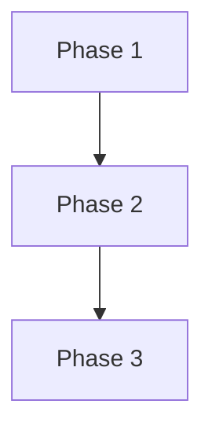

# Implementation Plan: Descriptor connect string quoting

## Overview

Record the bug as strict xfail integration tests first, then fix `save_connection`, then flip the markers and bump the version.

## Affected Files

| File | Change Type | Description |
| ---- | ----------- | ----------- |
| src/sqlcl_conn_mng/sqlcl.py | Update | Quote only the connect part in `save_connection` |
| tests/test_sqlcl.py | Update | Unit tests of the command text |
| tests/integration/test_saved_password_compat.py | Update | Remove the xfail, add a `?` parameter case |
| tests/integration/test_update_compat.py | Update | Update cases for a descriptor and for stored descriptors |
| pyproject.toml, uv.lock | Update | Version 0.9.1 |

## Phase 1: Record the bug with strict xfail tests

Requirements: REQ-2, REQ-3, REQ-4

### Implementation Work (Phase 1)

- Keep the strict xfail on `test_tool_add_with_descriptor`; add strict xfail tests for `add` with a `?` parameter string, `update --connect-string` with a descriptor, and `update --password-env` on stored descriptor and `?` connections.

### Test Work (Phase 1)

- Each new test carries `@pytest.mark.xfail(strict=True, reason="descriptor_connect_quoting: ...")`.

### Verification (Phase 1)

- `make db-start`, then the new tests with `-m integration`: all report XFAIL. `make db-stop`.

## Phase 2: Fix the quoting

Requirements: REQ-1, REQ-5

### Implementation Work (Phase 2)

- Change `save_connection` in `src/sqlcl_conn_mng/sqlcl.py` to build the quoted user, an `@`, and the connect part.

### Test Work (Phase 2)

- Add unit tests in `tests/test_sqlcl.py` for a safe string, a descriptor, a `?` parameter string and a user that needs quoting.

### Verification (Phase 2)

- `uv run pytest -q` passes; `make check` is clean.

## Phase 3: Flip the markers and bump the version

Requirements: REQ-2, REQ-3, REQ-4, REQ-6

### Implementation Work (Phase 3)

- Remove the xfail markers; set the version to 0.9.1 in `pyproject.toml` and run `uv lock`.

### Test Work (Phase 3)

- The former xfail tests now pass; a strict xfail that still fails would error, which is the signal.

### Verification (Phase 3)

- The integration suite against the podman container passes with no xfail left for this task; `uv run sqlcl-conn-mng --version` prints 0.9.1.

## Traceability

| REQ | Phase | Acceptance Criteria |
| --- | ----- | ------------------- |
| REQ-1 | Phase 2 | AC-1 |
| REQ-2 | Phase 1, Phase 3 | AC-2 |
| REQ-3 | Phase 1, Phase 3 | AC-3 |
| REQ-4 | Phase 1, Phase 3 | AC-4 |
| REQ-5 | Phase 2 | AC-1 |
| REQ-6 | Phase 3 | AC-5 |

## Dependency Graph

## Estimated Scope

| Phase | Source Files | Test Files | Effort |
| ----- | ------------ | ---------- | ------ |
| Phase 1 | 0 | 2 | Small |
| Phase 2 | 1 | 1 | Small |
| Phase 3 | 2 | 2 | Small |
