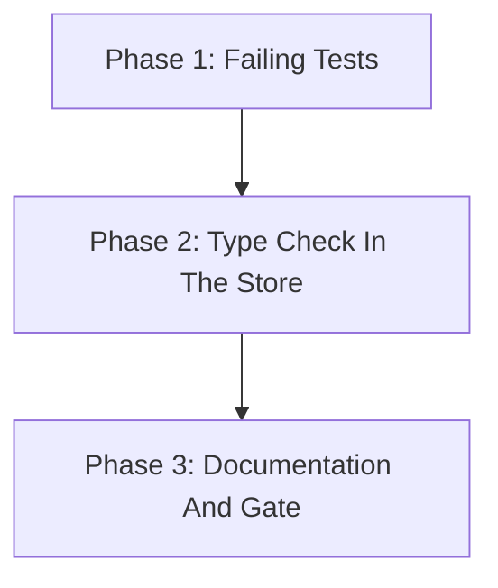

# Implementation Plan: Fix Malformed folders.json Crash

## Overview

Phase 1 turns the reproduction into failing tests. Phase 2 adds the list-type check in `store.py`. Phase 3 updates the README and runs the full gate plus the SQLcl-built reproduction.

## Affected Files

| File | Change Type | Description |
| ---- | ----------- | ----------- |
| src/sqlcl_conn_mng/store.py | Update | `_list_value` helper used by `folders()` and `_build_folder` |
| tests/test_store.py | Update | Non-list cases raise `StoreError` |
| tests/test_cli.py | Update | `main` exits 1 with no traceback |
| README.md | Update | "Store format" names the error |

## Phase 1: Failing Tests

Requirements: REQ-1, REQ-2

### Implementation Work (Phase 1)

- None in `src/`.

### Test Work (Phase 1)

- `tests/test_store.py`: `test_non_list_folder_values_raise_store_error`, parametrized over (top-level `folders`, nested `folders`, `connections`) x (`None`, `5`, `True`, `"x"`); asserts `StoreError`, `Malformed folders.json:` prefix, the key name and the folder path (`the top level` or `/dev`).
- `tests/test_cli.py`: `test_null_folders_json_exits_1_without_traceback`; `main(["list", "--home", ..., "--format", "json"])` returns 1 and stdout holds `{"status": "error", "command": "list", ...}`.

### Verification (Phase 1)

- `uv run pytest -q tests/test_store.py tests/test_cli.py` fails on the new tests with `TypeError` (or the misleading message for `"x"`), confirming the defect.

## Phase 2: Type Check In The Store

Requirements: REQ-1, REQ-2

### Implementation Work (Phase 2)

- `src/sqlcl_conn_mng/store.py`: add `_list_value(node, key, where) -> list[Any]`; call it in `folders()` for `folders` and in `_build_folder` for `connections` and `folders`.
- Keep the absent-key default and the `isinstance(c, str)` filter.

### Test Work (Phase 2)

- No new tests; Phase 1 tests now pass.

### Verification (Phase 2)

- `uv run pytest -q tests/test_store.py tests/test_cli.py` passes.

## Phase 3: Documentation And Gate

Requirements: REQ-3

### Implementation Work (Phase 3)

- `README.md` "Store format", `folders.json` bullet: add that invalid JSON or a non-list `folders` / `connections` value is reported as `Malformed folders.json` (exit 1).

### Test Work (Phase 3)

- None.

### Verification (Phase 3)

- `make check`, `make unit`, markdownlint on `README.md`, and the SQLcl-built reproduction from `analysis.md`.

## Traceability

| REQ | Phase | Acceptance Criteria |
| --- | ----- | ------------------- |
| REQ-1 | Phase 1, Phase 2 | AC-1, AC-2, AC-4, AC-6 |
| REQ-2 | Phase 1, Phase 2 | AC-3, AC-4, AC-6 |
| REQ-3 | Phase 3 | AC-5 |

## Dependency Graph

## Estimated Scope

| Phase | Source Files | Test Files | Effort |
| ----- | ------------ | ---------- | ------ |
| Phase 1 | 0 | 2 | Small |
| Phase 2 | 1 | 0 | Small |
| Phase 3 | 1 | 0 | Small |
