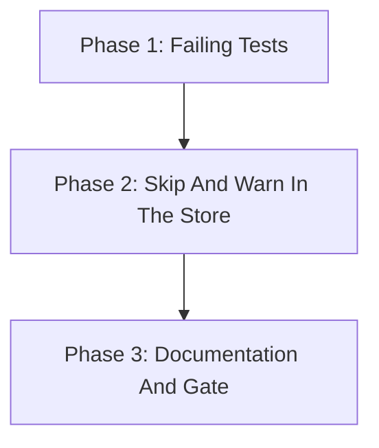

# Implementation Plan: Skip Unreadable Connection Properties

## Overview

Phase 1 turns the reproduction into failing tests. Phase 2 adds the skip-and-warn in `ConnectionStore.connections`. Phase 3 updates the README and runs the full gate plus the SQLcl-built reproduction.

## Affected Files

| File | Change Type | Description |
| ---- | ----------- | ----------- |
| src/sqlcl_conn_mng/store.py | Update | Module logger, `_skipped` set, `try/except ValueError` in `connections()` |
| tests/test_store.py | Update | Skip, single warning, direct reads still raise |
| tests/test_cli.py | Update | `list`, `folders`, `export` on a store with one broken file |
| README.md | Update | Skip behaviour and SQLcl crash note |
| pyproject.toml | Update | Version 0.9.2 to 0.9.3 |
| uv.lock | Update | Regenerated by `uv lock` for the new version |

## Phase 1: Failing Tests

Requirements: REQ-1, REQ-2, REQ-3

### Implementation Work (Phase 1)

- None in `src/`.

### Test Work (Phase 1)

- `tests/test_store.py`: `test_unparseable_properties_are_skipped_with_one_warning` on `fake_home` plus one extra id directory with `name=bad\u12zz` written via `write_bytes`; calls `connections()` twice on one instance, asserts three connections and exactly one `WARNING` record holding the id and the file path.
- `tests/test_store.py`: `test_direct_reads_of_unparseable_file_still_raise`: `read_properties` and `update_properties` raise `ValueError`; file bytes unchanged.
- `tests/test_cli.py`: `test_list_skips_unparseable_connection`: `main(["list", ..., "--format", "json"])` returns 0, stdout parses as JSON and holds the three good names.
- `tests/test_cli.py`: `test_folders_and_export_skip_unparseable_connection`: `folders --format json` and `export --output <tmp>` return 0 and exclude the broken connection.

### Verification (Phase 1)

- `uv run pytest -q tests/test_store.py tests/test_cli.py`: the skip tests fail with the `Malformed unicode escape` error; `test_direct_reads_of_unparseable_file_still_raise` already passes (it guards REQ-3 against the change).

## Phase 2: Skip And Warn In The Store

Requirements: REQ-1, REQ-2, REQ-3

### Implementation Work (Phase 2)

- `src/sqlcl_conn_mng/store.py`: `import logging`, `logger = logging.getLogger(__name__)`.
- `ConnectionStore.__init__`: `self._skipped: set[str] = set()`.
- `connections()`: wrap the parse; on `ValueError`, warn once per id (`Skipping connection %s: cannot parse %s: %s`) and continue.
- Update the `ConnectionStore` class docstring and `connections()` docstring.

### Test Work (Phase 2)

- No new tests; Phase 1 tests now pass.

### Verification (Phase 2)

- `uv run pytest -q tests/test_store.py tests/test_cli.py` passes.

## Phase 3: Documentation And Gate

Requirements: REQ-4, REQ-5

### Implementation Work (Phase 3)

- `README.md` "Store format": add a bullet that a connection whose `dbtools.properties` cannot be parsed is skipped with a warning naming the file, that `export` omits it, and that SQLcl fails on every command until the file is repaired or removed.
- `pyproject.toml`: bump `version` from 0.9.2 to 0.9.3, then `uv lock`.

### Test Work (Phase 3)

- None.

### Verification (Phase 3)

- `make check`, `make unit`, markdownlint on `README.md`, and the SQLcl-built reproduction from `analysis.md`.

## Traceability

| REQ | Phase | Acceptance Criteria |
| --- | ----- | ------------------- |
| REQ-1 | Phase 1, Phase 2 | AC-1, AC-4, AC-6 |
| REQ-2 | Phase 1, Phase 2 | AC-2, AC-4, AC-6 |
| REQ-3 | Phase 1, Phase 2 | AC-3, AC-6 |
| REQ-4 | Phase 3 | AC-5 |
| REQ-5 | Phase 3 | AC-7 |

## Dependency Graph

## Estimated Scope

| Phase | Source Files | Test Files | Effort |
| ----- | ------------ | ---------- | ------ |
| Phase 1 | 0 | 2 | Small |
| Phase 2 | 1 | 0 | Small |
| Phase 3 | 2 | 0 | Small |
