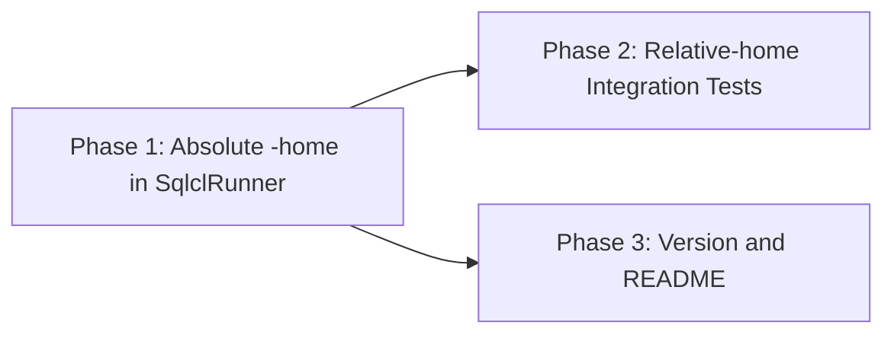
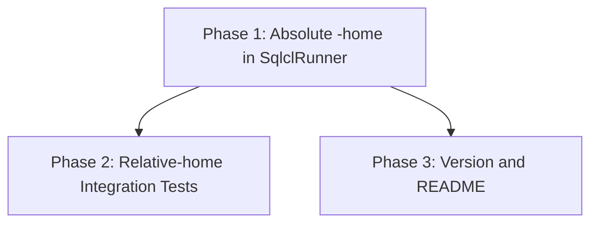

# Implementation Plan: Relative --home Breaks delete and delete-folder

## Overview

Make `SqlclRunner` pass an absolute `-home` to SQLcl, prove it with a unit test and two integration tests that use a relative `--home`, then bump the version and update the README.

## Affected Files

| File | Change Type | Description |
| ---- | ----------- | ----------- |
| `src/sqlcl_conn_mng/sqlcl.py` | Update | `SqlclRunner.__init__` stores `os.path.abspath(home)` |
| `tests/test_sqlcl.py` | Update | Update `test_argv_thin_and_thick`; add relative and absolute home tests |
| `tests/integration/test_connection_ops_compat.py` | Update | Add `delete` with relative `--home` |
| `tests/integration/test_folders_compat.py` | Update | Add `delete-folder --force` with relative `--home` |
| `pyproject.toml` | Update | 0.7.0 -> 0.7.1 |
| `uv.lock` | Update | Refreshed by `uv lock` |
| `README.md` | Update | `--home` row says the path is made absolute |

## Phase 1: Absolute -home in SqlclRunner

Requirements: REQ-1, REQ-3

### Implementation Work - Phase 1

- `src/sqlcl_conn_mng/sqlcl.py`: in `SqlclRunner.__init__`, set `self.home = os.path.abspath(home)` (`os` is already imported at `sqlcl.py:10`). Update the class docstring to say the store root is made absolute.

### Test Work - Phase 1

- `tests/test_sqlcl.py::test_argv_thin_and_thick`: expect `os.path.abspath("store-home")` after `-home`.
- Add `test_argv_makes_relative_home_absolute`: runner built with `"store-home"`; `argv()[argv().index("-home") + 1] == os.path.abspath("store-home")`.
- Add `test_argv_keeps_absolute_home`: runner built with `str(tmp_path)`; the value after `-home` equals `os.path.abspath(str(tmp_path))`.

### Verification - Phase 1

- `uv run pytest tests/test_sqlcl.py -q` passes.
- `make check` passes.

## Phase 2: Relative-home Integration Tests

Requirements: REQ-2, REQ-3

### Implementation Work - Phase 2

- No source change; this phase proves Phase 1 against real SQLcl.

### Test Work - Phase 2

- `tests/integration/test_connection_ops_compat.py`: add `test_tool_delete_relative_home(conn_ops_store, run_cli, tmp_path, monkeypatch)`. Copy the store, `monkeypatch.chdir(copy.parent)`, run `run_cli(Path(copy.name), "delete", "--name", "c_nopwd", "--yes")`; assert exit 0, `c_nopwd` not in `listed(...)`, and no `SEVERE` in `result.stdout + result.stderr`.
- `tests/integration/test_folders_compat.py`: add `test_tool_force_delete_folder_relative_home(folder_store, run_cli, tmp_path, monkeypatch)` with the same steps and assertions as `test_tool_force_delete_folder`, but run through the relative path, plus the no-`SEVERE` check.
- Before the Phase 1 change is in place, both tests fail (exit 1); confirm this once by stashing the Phase 1 source change, then restore it.

### Verification - Phase 2

- `uv run pytest -m integration -q -k relative_home` passes with SQLcl on PATH or `SQLCL_BIN` set.
- `make integration` passes.

## Phase 3: Version and README

Requirements: REQ-4, REQ-5

### Implementation Work - Phase 3

- `pyproject.toml`: `version = "0.7.1"`; run `uv lock`.
- `README.md:142`: change the `--home` description to say the path is made absolute before it is passed to SQLcl as `-home`.

### Test Work - Phase 3

- None beyond the full suites.

### Verification - Phase 3

- `uv run sqlcl-conn-mng --version` prints `0.7.1`.
- markdownlint-cli2 on `README.md` is clean.
- Reinstall the global copy with `uv tool install --from . sqlcl-conn-mng --reinstall` only if `git worktree list` shows the main checkout alone; otherwise skip and say so.

## Traceability

| REQ | Phase | Acceptance Criteria |
| --- | ----- | ------------------- |
| REQ-1 | Phase 1 | AC-1, AC-4, AC-7 |
| REQ-2 | Phase 2 | AC-2, AC-3, AC-7 |
| REQ-3 | Phase 1, Phase 2 | AC-1, AC-2, AC-3, AC-7 |
| REQ-4 | Phase 3 | AC-5 |
| REQ-5 | Phase 3 | AC-6 |

## Dependency Graph

## Estimated Scope

| Phase | Source Files | Test Files | Effort |
| ----- | ------------ | ---------- | ------ |
| Phase 1 | 1 | 1 | Small |
| Phase 2 | 0 | 2 | Small |
| Phase 3 | 3 | 0 | Small |
