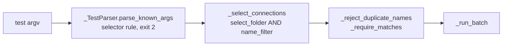
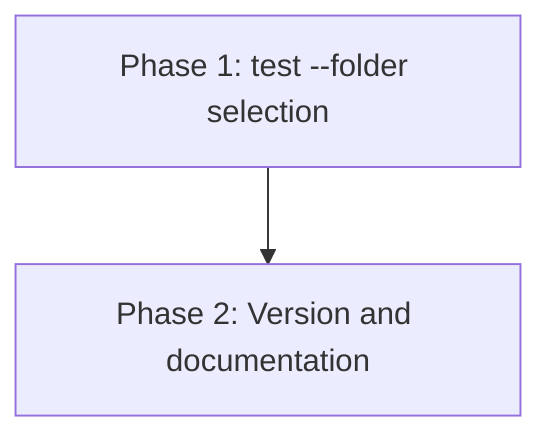

# Implementation Plan: Folder Selection For test

## Overview

Two phases. Phase 1 gives `test` its own selector set (`--name` / `--all` / `--folder` + `--filter`), validated by a parser subclass so usage errors stay exit 2, and threads the folder through the shared selection code under a dedicated dest. Phase 2 bumps the version to 0.6.0 and documents the option in `README.md` and the agent skill.

## Affected Files

| File | Change Type | Description |
| ---- | ----------- | ----------- |
| `src/sqlcl_conn_mng/cli.py` | Update | `test` selector helper and parser subclass; folder narrowing in `_select_connections`; `_describe_selection` names the folder |
| `tests/test_cli.py` | Update | Root-folder pin; parser rule, selection, empty match, batch and regression tests for `test --folder` |
| `pyproject.toml` | Update | Version 0.6.0 |
| `uv.lock` | Update | Refreshed by `uv lock` |
| `README.md` | Update | Command table, Batch selection, JSON output, Examples |
| `.claude/skills/sqlcl-conn-mng/SKILL.md` | Update | Command table, selector paragraph, minimum version |

## Phase 1: test --folder selection

Requirements: REQ-1, REQ-2, REQ-3, REQ-4, REQ-7, REQ-8

### Implementation Work (Phase 1)

- In `src/sqlcl_conn_mng/cli.py` add `_TestSelectorParser(argparse.ArgumentParser)` overriding `parse_known_args`: after the base call, if none of `name`, `select_all`, `name_filter`, `select_folder` is set, `self.error("one of the arguments --name --filter --folder --all is required")`; if `name` or `select_all` is set together with `name_filter` or `select_folder`, `self.error("argument --X: not allowed with argument --Y")` naming the pair.
- Add `_add_test_selector(parser)`: an optional mutually exclusive group with `--name` and `--all` (dest `select_all`), then `--filter` (dest `name_filter`, help "Connections whose name matches the case-sensitive glob PATTERN; combines with --folder as AND.") and `--folder` (dest `select_folder`, help "Connections in this folder or below; combines with --filter as AND.").
- In `build_parser`, pass `parser_class=_TestSelectorParser` to `add_subparsers` and `test_selector=True` to the `test` `add_parser` call (argparse has no per-command `parser_class`; see `notes.md` D-1 and `solution_01.md`), and replace `_add_selector(p)` with `_add_test_selector(p)`. `show`, `delete`, `move` keep `_add_selector`.
- In `_select_connections`, in the non-`--name`, non-`select_all` branch: narrow by `_in_folder(c, folder)` when `getattr(args, "select_folder", None)` is set, then by `_matches(c.name, args.name_filter)` when `name_filter` is set.
- In `_describe_selection`, return `--all`, else join `--folder {folder!r}` and `--filter {pattern!r}` for the parts given, folder first.
- `_cmd_test` and `_run_batch` need no change.

### Test Work (Phase 1)

- `tests/test_cli.py`: remove `["test"]` from `SELECTOR_COMMANDS`; keep `show`, `delete`, `move` there unchanged.
- Add `test_test_selector_rules`: `parse_args` accepts `--name a`, `--all`, `--filter a*`, `--folder /dev`, `--folder /dev --filter a*`; exits 2 for no selector, `--name a --all`, `--name a --filter a`, `--name a --folder /dev`, `--all --filter a`, `--all --folder /dev`.
- Add `test_test_selector_rules_through_main`: the same forbidden sets through `main` exit 2 and run no SQLcl.
- Add `test_test_folder_matches_list`: `test --folder /dev` with mocked SQLcl runs exactly `dev_local`, equal to the names of `list --folder /dev --format json`.
- Add `test_test_folder_and_filter`: `--folder /dev --filter 'dev_*'` runs `dev_local`; `--folder /dev --filter 'root_*'` exits 1 with no SQLcl run.
- Add `test_test_folder_empty_message`: `--folder /nope` logs `No connections match --folder '/nope'`; `--folder /dev --filter 'x*'` logs `No connections match --folder '/dev' --filter 'x*'`; with `--format json` the error envelope carries the same message.
- Add `test_test_folder_batch_output`: table lines and summary; JSON batch envelope; one failing connection gives exit 1.
- Add `test_test_folder_rejects_duplicate_names`: a store with two `dev_local` connections in `/dev/local` is refused for `--folder /dev`, no SQLcl run.
- Add `test_root_folder_is_root_only`: `list --folder /` returns only `root_conn`, and `test --folder /` with mocked SQLcl runs `root_conn` only (REQ-8).
- Add `test_move_folder_is_not_a_selector`: `move --filter '*_*' --folder /x` moves `dev_local` and `root_conn` into `/x` (or extend the existing `test_move_batch_passes_folder_to_each` assertion if it already checks both names).

### Verification (Phase 1)

- `make check` - clean.
- `make unit` - all pass, including the new tests.
- `uv run sqlcl-conn-mng test --help` lists `--folder` and `--filter` with the AND wording.

## Phase 2: Version and documentation

Requirements: REQ-5, REQ-6

### Implementation Work (Phase 2)

- `pyproject.toml`: `version = "0.6.0"`; run `uv lock`.
- `README.md`: in the Commands table add a `test` `--folder` row and change the `test` selector row to "`--name` / `--all` / `--folder` and/or `--filter`"; in Batch selection describe the `test` selector rule and the AND combination, and that `--folder` uses the same folder-or-below match as `list`, and that `--folder /` selects only root-level connections; extend the `list` `--folder` row with the same root note; in JSON output add `--folder` to the batch list; in Examples add `MSYS_NO_PATHCONV=1 sqlcl-conn-mng test --folder /dev/local` and the `--folder` + `--filter` form.
- `.claude/skills/sqlcl-conn-mng/SKILL.md`: add a "Test a folder" row with `MSYS_NO_PATHCONV=1 sqlcl-conn-mng test --home .sqlcl --folder /dev/local` (and `--filter` AND form); update the selector paragraph to state the `test` rule; state that 0.6.0 or newer is needed for `test --folder`; add `--folder` to the JSON batch line.
- Reinstall any global copy: `uv tool install --from . sqlcl-conn-mng --reinstall`, only if one is installed (`uv tool list`).

### Test Work (Phase 2)

- No new tests; the version test (`test_version_flag`) reads `__version__` and keeps passing.

### Verification (Phase 2)

- `uv run sqlcl-conn-mng --version` prints `sqlcl-conn-mng 0.6.0`.
- `markdownlint-cli2 README.md .claude/skills/sqlcl-conn-mng/SKILL.md docs/tasks/test_folder_filter/*.md` - no errors.
- `make check` and `make unit` - clean.

## Traceability

| REQ | Phase | Acceptance Criteria |
| --- | ----- | ------------------- |
| REQ-1 | Phase 1 | AC-1 |
| REQ-2 | Phase 1 | AC-2, AC-3 |
| REQ-3 | Phase 1 | AC-4 |
| REQ-4 | Phase 1 | AC-1, AC-5 |
| REQ-5 | Phase 2 | AC-6 |
| REQ-6 | Phase 2 | AC-7 |
| REQ-7 | Phase 1 | AC-8 |
| REQ-8 | Phase 1 | AC-9 |

## Dependency Graph

## Estimated Scope

| Phase | Source Files | Test Files | Effort |
| ----- | ------------ | ---------- | ------ |
| Phase 1 | 1 | 1 | Medium |
| Phase 2 | 4 | 0 | Small |
